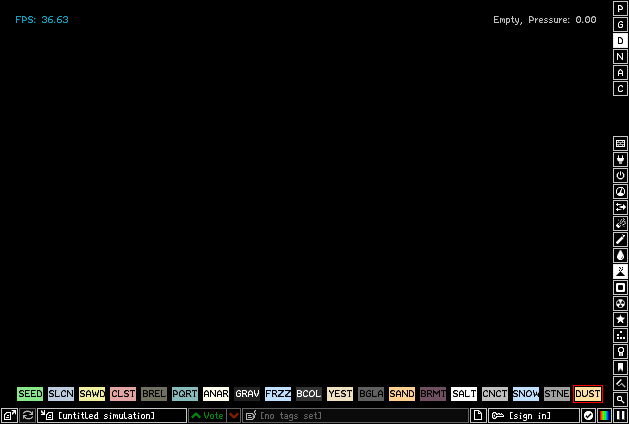
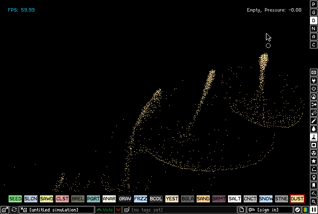
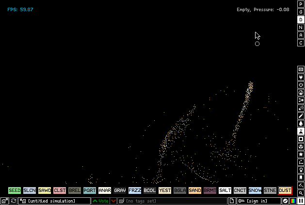

# The Powder Toy for the Amiga

The Powder Toy is a falling-sand physics sandbox: pour powders, liquids
and gases, heat them, burn them, electrify them and watch nearly two
hundred elements react, with air pressure and heat simulated across the
whole field.

This is the AmigaOS 3.x port of The Powder Toy 100.1.400, on OpenGPU's
SDL 2.

## Controls

| Control            | Does                                        |
|--------------------|---------------------------------------------|
| Left mouse button  | Draw the selected element                   |
| Right mouse button | Erase                                       |
| Element bar        | Pick an element; the right-hand column picks the category |
| Space              | Pause and resume                            |
| [ / ], mouse wheel | Brush size                                  |
| Close gadget       | Quit                                        |

## Requirements

- AmigaOS 3.x, a 68040 or 68060 with an FPU (the simulation is heavy:
  the faster the better)
- An RTG card (or AmigaChrome)
- OpenGPU 0.6 or later (OpenUp installs it): SDL2.module
- About 5 MB of disk

## Running it

Unpack the archive, open the ThePowderToy drawer and double-click
ThePowderToy. Settings, saves and stamps are kept in the drawer.

Online saves, Lua scripts and Newtonian gravity are not in this build;
building, what was changed and the known limits are in
[AMIGA_PORT.md](AMIGA_PORT.md). Upstream's README is
[README.upstream.md](README.upstream.md).

## Licence

GPL 3 (LICENSE).
